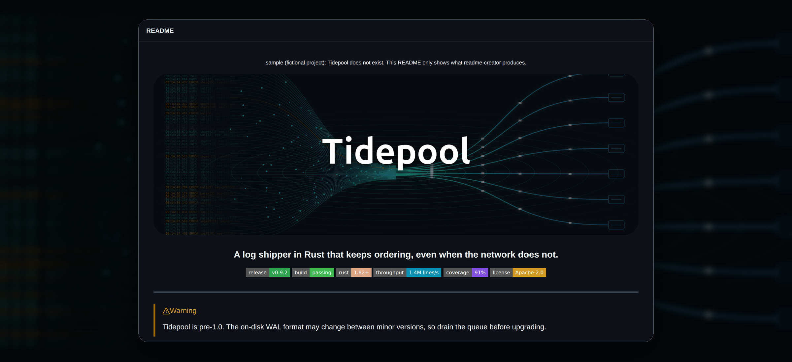

<div align="center">

<p align="center"></p>

<p align="center"><a href="README.md">English</a> | <b>日本語</b></p>

<h1 align="center">README Creator SKILL</h1>

<h3 align="center">有名リポジトリのような README を作る、Claude 向けのスキル。</h3>

<p align="center">中央寄せのバナー、色分けしたバッジ、GitHub の Alert、折りたたみの表、そろえた英日の2言語版を作ります。見た目より事実を優先します。</p>

<p align="center">
  <a href="https://github.com/Lapius7/readme-skill/stargazers"></a>
  <a href="https://github.com/Lapius7/readme-skill/commits/main"></a>
  <a href="https://docs.claude.com/en/docs/claude-code/skills"></a>
  <a href="https://github.com/python-pillow/Pillow"></a>
</p>

<p align="center">
  <a href="#できること">できること</a> ·
  <a href="#インストール">インストール</a> ·
  <a href="#使い方">使い方</a> ·
  <a href="#含まれるもの">含まれるもの</a>
</p>

</div>

---

Claude に「READMEを良くして」「バッジとバナーを付けて」と頼むと、このスキルがいくつか質問し（どれも既定値があるので、答えなくても進みます）、README を書き、リポジトリを整え、結果を確かめます。

## できること

- **先に質問**: 言語、バナー、既存の README の扱い、リポジトリを整える範囲、公開の方法を聞きます。質問にはすべて既定値があり、依頼の中に答えがあるものは聞き直しません。
- **構成**: 言語切替、バナー、キャッチコピー、バッジ、概要、特長、クイックスタート、ツール、設定、安全のために、今後の予定、ライセンスの順に並べます。README は、そのソフトを使う人のための文書です。作る人や公開する人のための手順は書きません。
- **バナー**: プロジェクトの実物のレンダリングやスクリーンショットから、角丸の横長画像に大きな白字でプロジェクト名を重ねます。ありふれた見た目になるときは付けません。
- **バッジ**: shields.io の `flat-square` で、バッジごとに色とロゴを付けます。リンク先が実在するものと、公開済みのものだけにします。
- **Alert**: `NOTE`、`TIP`、`IMPORTANT`、`WARNING`、`CAUTION` を、意味のある所にだけ使います。絵文字は使いません。
- **言語は指定できる**: 既定は英語と日本語です。ほかの言語を指定すると、言語ごとに `README.<言語コード>.md` を作り、同じ構成にして、先頭に言語切替を置きます。日本語は、[Tsuzuri](https://github.com/MaryCache/tsuzuri) が使えるときは Tsuzuri で、使えないときは `yomiyasu` スキルで推敲します。
- **リポジトリの整備**: GitHub がタブやテンプレートとして出すもの（License、Security、Contributing、Issue テンプレート、リリースノート）を足し、About の説明と topics を設定します。
- **事実を優先**: ツール名、上限値、設定名は、コードと照合します。実機で試していないことは、未検証と書きます。
- **点検**: `scripts/audit-repo.py` が、置き換え忘れ、切れたバッジとリンク、言語版どうしで食い違う章、足りないファイルを調べます。

## インストール

Claude Code がスキルを探す場所へ、フォルダーを置きます。

```sh
git clone https://github.com/Lapius7/readme-skill ~/.claude/skills/readme-skill
```

スクリプトには [uv](https://docs.astral.sh/uv/) が必要です。バナーのスクリプトは Pillow も使い、`uv run` が必要なときに取得します。リポジトリの整備には [GitHub CLI](https://cli.github.com/)（`gh`）を使います。

> [!NOTE]
> 日本語の推敲には、[Tsuzuri](https://github.com/MaryCache/tsuzuri) を優先し、なければ `yomiyasu` スキルを使います。どちらもなくても動きますが、その場合は日本語の推敲が行われません。

## 使い方

普通の言葉で頼みます。例:

- 「このリポジトリの README を書いて」
- 「README を良くして。バッジとバナーも付けて」
- 「リポジトリを整えて。ライセンスとセキュリティポリシーと Issue テンプレートも」
- 「リポジトリを改名したので、README の URL を直して」

リポジトリの点検だけを行うには、次を実行します。

```sh
python3 ~/.claude/skills/readme-skill/scripts/audit-repo.py path/to/repo
```

直すものと検討するものを一覧にします。ファイルは変更しません。バナーだけを作るには、次を実行します。

```sh
uv run --with pillow python scripts/make-banner.py "Project Name" docs/images/hero.png docs/images/banner.png
```

元画像の既定は `docs/images/hero.png`、出力の既定は `docs/images/banner.png` で、どちらも実行したフォルダーが基準です。

## 含まれるもの

| パス | 役割 |
|---|---|
| `SKILL.md` | Claude が従う指示です。質問、手順、構成、バナー、バッジ、Alert、リポジトリの整備、守ることをまとめています。 |
| `templates/README.template.md` | 中央寄せの先頭部、バッジ行、Alert、折りたたみの表を備えた、README のひな形です。 |
| `templates/quickstart-by-language.md` | Node、Python、Rust、Go、Docker、Gradle、Web アプリ向けの、導入と実行のコマンドとバッジです。 |
| `templates/github/` | `SECURITY.md`、`CONTRIBUTING.md`、Issue フォーム、リリースノートのひな形です。 |
| `scripts/make-banner.py` | プロジェクト名を重ねた、角丸のバナーを作ります。 |
| `scripts/audit-repo.py` | README、リンク、ファイル、About の設定を点検します。 |
| `examples/sample-readme/` | このスキルで作った README の見本です。 |

## ライセンス

MIT です。[LICENSE](LICENSE) を参照してください。同梱の `scripts/vendor` の CSS は github-markdown-css（MIT、Sindre Sorhus）です。
