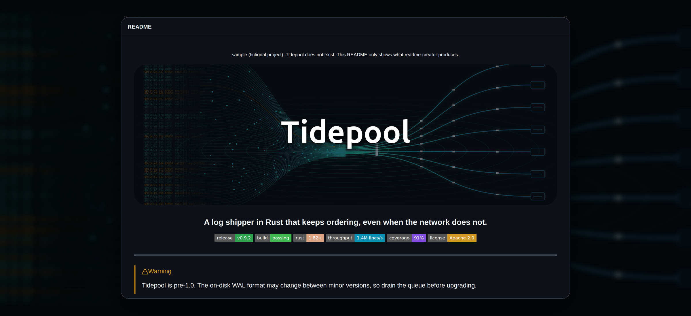

<div align="center">

<p align="center"></p>

<p align="center"><b>English</b> | <a href="README.ja.md">日本語</a></p>

<h1 align="center">README Creator SKILL</h1>

<h3 align="center">A Claude skill that writes READMEs that look like the well-known repositories.</h3>

<p align="center">Centered banner, colored badges, GitHub Alerts, collapsible tables, and matching English and Japanese versions. Facts first, decoration second.</p>

<p align="center">
  <a href="https://github.com/Lapius7/readme-skill/stargazers"></a>
  <a href="https://github.com/Lapius7/readme-skill/commits/main"></a>
  <a href="https://docs.claude.com/en/docs/claude-code/skills"></a>
  <a href="https://github.com/python-pillow/Pillow"></a>
</p>

<p align="center">
  <a href="#what-it-does">What it does</a> ·
  <a href="#install">Install</a> ·
  <a href="#usage">Usage</a> ·
  <a href="#whats-included">What's included</a>
</p>

</div>

---

Ask Claude for "a better README" or "a README with badges and a banner". The skill asks a few questions (each has a default, so you can skip them), writes the README, sets up the repository around it, and checks the result.

## What it does

- **Asks first**: language, banner, how to treat an existing README, how far to tidy the repository, and how to publish. Every question has a default, and answers already in your request are not asked again.
- **Structure**: language switch, banner, tagline, badges, overview, features, quick start, tools, configuration, safety, roadmap, license, in that order. The README is for the people who use the software, not for the people who build or release it.
- **Banner**: a rounded wide image with the project name in large white text, made from a real render or screenshot of the project. Skipped when it would look generic.
- **Badges**: shields.io `flat-square`, one color and one logo per badge. Only links that exist, and only for things that are already published.
- **Alerts**: `NOTE`, `TIP`, `IMPORTANT`, `WARNING`, `CAUTION`, used where they mean something, with no emoji.
- **Any languages you choose**: English and Japanese by default. Name other languages and it writes `README.<language code>.md` for each, with the same structure and a language switch at the top. Japanese is proofread with [Tsuzuri](https://github.com/MaryCache/tsuzuri) when it is available, and with `yomiyasu` when it is not.
- **Repository tidy-up**: adds what GitHub shows as tabs and templates (License, Security, Contributing, issue templates, release notes), and fills in the About description and topics.
- **Facts first**: tool names, limits, and settings are checked against the code. What was not tried on a real setup is marked as unverified.
- **Checks**: `scripts/audit-repo.py` finds leftover placeholders, dead badges and links, sections that differ between language versions, and missing files.

## Install

Put the folder where Claude Code looks for skills.

```sh
git clone https://github.com/Lapius7/readme-skill ~/.claude/skills/readme-skill
```

The scripts need [uv](https://docs.astral.sh/uv/). The banner script also needs Pillow, which `uv run` fetches on demand. The repository tidy-up uses the [GitHub CLI](https://cli.github.com/) (`gh`).

> [!NOTE]
> For Japanese proofreading the skill uses [Tsuzuri](https://github.com/MaryCache/tsuzuri) first and `yomiyasu` second. It still works with neither, but the Japanese text is then not proofread.

## Usage

Ask in plain words. Examples:

- "Write a README for this repository."
- "Make the README look better, with badges and a banner."
- "Set up the repository properly: license, security policy, issue templates."
- "I renamed the repository. Fix the URLs in the README."

To check a repository on its own:

```sh
python3 ~/.claude/skills/readme-skill/scripts/audit-repo.py path/to/repo
```

It lists what to fix and what to consider, and changes nothing. To make only the banner:

```sh
uv run --with pillow python scripts/make-banner.py "Project Name" docs/images/hero.png docs/images/banner.png
```

The source image defaults to `docs/images/hero.png`, and the output to `docs/images/banner.png`, relative to the directory you run it in.

## What's included

| Path | Purpose |
|---|---|
| `SKILL.md` | The instructions Claude follows: questions, steps, structure, banner, badges, alerts, repository tidy-up, rules. |
| `templates/README.template.md` | A starting README with the centered header, badge row, alerts, and collapsible table. |
| `templates/quickstart-by-language.md` | Install and run commands and badges for Node, Python, Rust, Go, Docker, Gradle, and web apps. |
| `templates/github/` | Templates for `SECURITY.md`, `CONTRIBUTING.md`, issue forms, and release notes. |
| `scripts/make-banner.py` | Makes the rounded banner with the project name. |
| `scripts/audit-repo.py` | Checks the README, links, files, and About settings. |
| `examples/sample-readme/` | A sample README produced with the skill. |

## License

MIT. See [LICENSE](LICENSE). The bundled `scripts/vendor` CSS is github-markdown-css (MIT, Sindre Sorhus).
