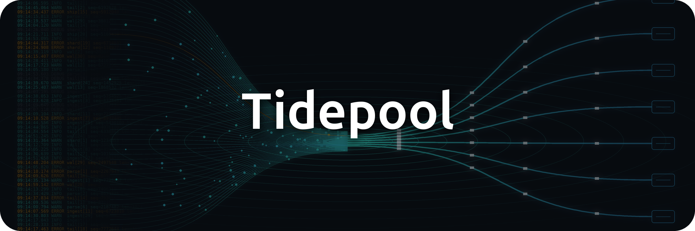

<div align="center">

<sub>sample (fictional project): Tidepool does not exist. This README only shows what readme-skill produces.</sub>



<h3 align="center">A log shipper in Rust that keeps ordering, even when the network does not.</h3>

<p align="center">
  <a href="#"></a>
  <a href="#"></a>
  <a href="#"></a>
  <a href="#"></a>
  <a href="#"></a>
  <a href="#"></a>
</p>

</div>

---

> [!WARNING]
> Tidepool is pre-1.0. The on-disk WAL format may change between minor versions, so drain the queue before upgrading.

Tidepool tails files and journald, buffers records in a write-ahead log (WAL), and ships them to one or more sinks with at-least-once delivery. Per-source ordering is kept across restarts and sink outages.

> [!NOTE]
> Numbers in this README come from the benchmark in `bench/`, run on 8 vCPU, NVMe, 1 KiB records.

## Architecture

```text
 sources            pool                          sinks
 ┌────────┐       ┌───────────────────┐       ┌──────────────┐
 │ file   │──┐    │  parse → enrich   │    ┌─▶│ Loki         │
 │ journal│──┼───▶│        │          │────┤  │ S3 (zstd)    │
 │ syslog │──┘    │      WAL (fsync)  │    └─▶│ Kafka        │
 └────────┘       └───────────────────┘       └──────────────┘
```

| Stage  | Role                              | Backpressure        |
| ------ | --------------------------------- | ------------------- |
| source | read, assign `(source, seq)`      | pauses the read     |
| pool   | parse, enrich, append to the WAL  | bounded by WAL size |
| sink   | batch, send, ack, trim the WAL    | retry with jitter   |

## Quick start

```sh
cargo install tidepool
tidepool init --sink loki=http://localhost:3100
tidepool run -c tidepool.toml
```

```toml
# tidepool.toml
[wal]
dir = "/var/lib/tidepool"
max_size = "8GiB"

[[source]]
kind = "file"
paths = ["/var/log/app/*.log"]

[[sink]]
kind = "loki"
url = "http://localhost:3100"
batch = { lines = 5000, wait = "250ms" }
```

<details>
<summary><b>Benchmarks</b> (click to expand)</summary>

| Sinks | Lines/s | p99 latency | CPU   |
| ----- | ------- | ----------- | ----- |
| 1     | 1.40M   | 38 ms       | 310 % |
| 3     | 1.12M   | 61 ms       | 480 % |
| 3, one down | 1.10M | 74 ms   | 495 % |

</details>

> [!IMPORTANT]
> Set `wal.max_size` larger than your longest expected sink outage times your peak rate. When the WAL is full, sources pause and nothing is dropped.

## License

Apache-2.0
